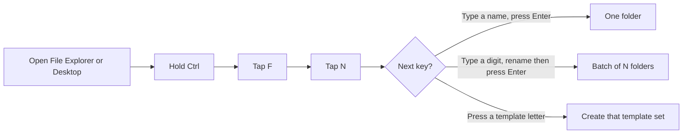
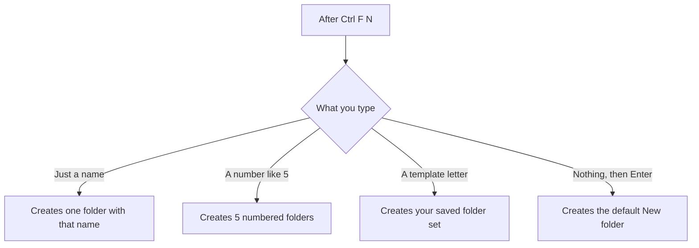
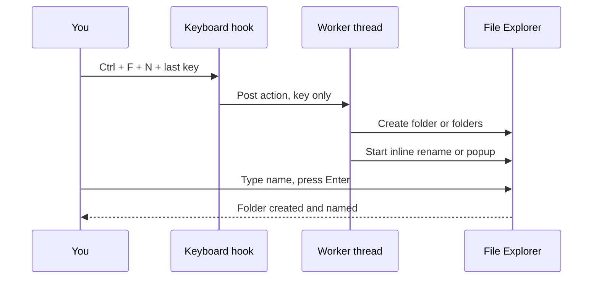

# 📁 Explorer Ctrl + F + N → New Folder


A [Windhawk](https://windhawk.net) mod for Windows File Explorer. Make a folder — **and name it in the same motion** — without touching the mouse. Also does batches and reusable folder templates.

> ⌨️ **F** for *Folder*, **N** for *Name*. Hold **Ctrl** the whole time.

Works in any real File Explorer directory, sub-folders, and the Desktop. Non-filesystem spots (*This PC*, *Quick access*) are skipped.

---

## The gesture



- **Hold Ctrl for the entire gesture.** Let go early and nothing is created.
- **Esc** cancels - the temporary folder is removed and nothing is created. (Pressing **Enter** on an empty name is what keeps the default `New folder`.)
- Only **one** shortcut is active at a time.

---

## Quick start

1. Click an empty spot in a folder or the Desktop.
2. Hold **Ctrl** → tap **F** → tap **N**.
3. Type a name → **Enter**. Done.

That is the whole thing. Batch and templates are the same gesture with a different last key.

---

## Requirements

| Need | Detail |
|---|---|
| OS | Windows with File Explorer |
| Windhawk | Installed and running ([windhawk.net](https://windhawk.net)) |

## Install

1. Open **Windhawk** → **Explore**.
2. Search for **Explorer Ctrl+F+N to New Folder**.
3. Click **Install**, then **Enable**.

Manual: Windhawk → **Create new mod** → paste the contents of `ctrlg-group.wh.cpp` → **Compile** → **Enable**.

---

## What each last key does



### One folder
Type a name, press Enter. Empty name falls back to `New folder`.

### Batch — several at once
Type a number right after the gesture, then Enter. `5` makes five folders. Cap is **100**.

Numbering never overwrites — existing folders are skipped and the batch continues past the highest number.

| Batch pattern | Result for base `New folder` |
|---|---|
| `New folder 1` *(default)* | `New folder 1`, `New folder 2`, `New folder 3` |
| `New folder-01` | `New folder-01`, `New folder-02`, `New folder-03` |
| `New folder-001` | `New folder-001`, `New folder-002`, `New folder-003` |
| `New folder_01` | `New folder_01`, `New folder_02` |
| `New folder_001` | `New folder_001`, `New folder_002` |
| `New folder (01)` | `New folder (01)`, `New folder (02)` |

---

## Folder templates

Make the **same set of folders every time** with one keypress. Press your trigger, then the template **letter** — no typing, no rename box.

Define templates in the mod settings, **one per line**:

```
key=Name=Folder1|Folder2|Folder3
```

| Line you write | Press | Creates |
|---|---|---|
| `i=Image=raw\|jpg\|png` | `i` | `raw`, `jpg`, `png` |
| `w=Work=src\|docs\|assets` | `w` | `src`, `docs`, `assets` |
| `p=Project=01 Brief\|02 Assets\|03 Final` | `p` | `01 Brief`, `02 Assets`, `03 Final` |

**Rules**

| Rule | Meaning |
|---|---|
| **key** | One letter A–Z you press after the trigger. Case-insensitive, stored lowercase. |
| **Name** | A label for your reference only. |
| **Folders** | Split on the `\|` pipe. Each piece is one folder. Spaces are kept exactly. |
| **26 templates max** | One per letter. Same key twice → the first line wins. |
| **100 folders max** | Per template. |
| **Rejected names** | Anything with `\` `/` `:` `*` `?` `"` `<` `>` `\|` `..`, or control characters, is skipped — same rules as a typed folder name. Commas are allowed. |
| **Never overwrites** | Existing folders follow the *Template name collisions* setting. |

---

## How it works under the hood

The keyboard hook stays non-blocking — it captures only the key and hands the work to a worker thread, which creates the folders **and only then** starts the rename. That ordering is what keeps naming reliable.



---

## Settings

| Setting | Default | What it does |
|---|---|---|
| **Shortcut** | `Ctrl+F+N` | Pick one of 5: `Ctrl+F+N`, `Ctrl+Shift+N`, `Ctrl+N`, `Ctrl+N+F`, `Ctrl+Q`. Only one active at a time. (`Ctrl+G` is **not** here — it's the dedicated *Group Creation* key, see below.) |
| **Name folders with a popup box** | OFF | OFF *(default)* = Explorer's native inline rename box. ON = themed light/dark popup, type + Create. Both modes available; only affects Ctrl+F+N. |
| **Multiple folders in one go** | ON | Controls **batches** only. ON = type a number for a batch. OFF = one folder. **Folder templates work either way** — a template letter always fires. |
| **Max folders per run** | 25 | Cap per trigger, range 1–100. |
| **Auto-resolve name clashes** | ON | ON = numbers past existing names. OFF = only plain `New folder`. |
| **Open the new folder after creating it** | OFF | ON = browse into it in the same window. Single-folder only. |
| **Type speed** | Normal | Grace period before the box commits on its own. Normal ≈ 1.2s / 30s, Relaxed ≈ 2.5s / 60s, Patient ≈ 4s / 120s. |
| **Batch numbering pattern** | `New folder 1` | Number style for batches. 6 options. |
| **Folder templates** | *(empty)* | Your own folder sets. One `key=Name=Folder1\|Folder2` per line. |
| **Template name collisions** | Skip | For templates only: `Skip` existing, `number` a sibling, or `stop` (create nothing). Overrides *Auto-resolve name clashes*. |
| **Group Creation (Ctrl+G)** | ON | Master on/off for the Ctrl+G *group creation* feature. Ctrl+G **always opens a popup first** — type the folder name, pick Move/Copy, press Create; nothing is created until you do. OFF = Ctrl+G does nothing (Explorer keeps the key). |
| **Group by Move or Copy** | Copy | What Ctrl+G does with the selected items. `Copy` keeps the originals; `Move` relocates them. Flip it per-group with the popup's Move/Copy button. |
| **When the destination folder already exists** | Use existing | Only matters when a folder with the name you typed is **already in the destination**. `Use existing` drops the items into it (nothing overwritten — great for regrouping into the same target); `Numbered` leaves it alone and makes a fresh sibling (`Trip`, `Trip 2`, …); `Cancel` does nothing. (A same-named *file* inside the destination is the row below.) |
| **When a file with the same name is already there** | Ask | Controls the "Replace or Skip Files" case. `Ask` shows Windows' native box. `Replace` overwrites, no prompt. `Skip` keeps the existing file, no prompt. `Compare` shows the native box with *Compare info for both files*. |
| **Fixed destination folder** | *(empty)* | Optional. Blank = group into the selection's own parent using the name you type in the popup. Set a full path = Ctrl+G always groups straight **into that folder** (the typed name isn't used for the destination). |
| **Open destination after grouping** | OFF | ON = open the destination folder after grouping. |

---

## Why Ctrl + F + N

| | Ctrl+F+N | Ctrl+Shift+N | Ctrl+N | Ctrl+N+F | Ctrl+Q |
|---|---|---|---|---|---|
| Keys | Hold Ctrl, tap F then N | Windows' own New folder keys | Single press | Hold Ctrl, tap N then F | Single press |
| Keeps native Explorer shortcuts | ✅ Ctrl+F search still works | ✅ | ❌ replaces New window | ❌ replaces New window | ✅ uses a free key |
| Accidental-trigger risk | Low | Low | Higher | Medium | Higher |

Pick **Ctrl+F+N** to keep every native Explorer shortcut intact, or **Ctrl+Shift+N** for the exact keys Windows already uses. **Ctrl+Q** is a free single-press key that doesn't collide with a native shortcut. (`Ctrl+G` is reserved for *Group creation* below and is not a New Folder trigger.)

---

## Group creation (Ctrl+G)

Grab a bunch of files/folders and drop them into **one** folder — without dragging.

1. Select the items in File Explorer.
2. Press **Ctrl+G**.
3. In the popup, review the selection, type the folder name (or leave blank to reuse the last target), pick **Copy** or **Move**, and confirm.

The popup shows the **item count**, the **item list**, the **folder-name field**, a **Move/Copy** toggle, and the **destination** plus the **last target** you used.

- **Copy** is the default (originals stay put); **Move** relocates them.
- If a folder with that name **already exists**, the default is to **use it** — perfect for repeatedly grouping into the same target. You can switch to a fresh numbered folder or cancel instead.
- If a **file with the same name** already exists in the destination (the "Replace or Skip Files" case), the default is to **Ask** with Windows' native box. Set it to **Replace**, **Skip**, or **Compare** to decide up front — see *When a file with the same name is already there*.
- Set an optional **fixed destination** to always group into one folder, or leave it blank to group into the selection's own parent.
- **Open destination after grouping** is **off** by default.
- Ctrl+G is **dedicated** to grouping — it is separate from the New Folder shortcut and never creates a plain folder. Turn the whole feature on/off with the **Group Creation (Ctrl+G)** setting.

---

## Auto Group — organize by extension (Ctrl+G)

In the same Ctrl+G popup, **Auto Group** sorts the selection into extension folders for you — no folder name to type.

1. Select the items, press **Ctrl+G**.
2. The footer shows `[Auto Group (8)] [Group] [Cancel]`. Auto Group is locked for **8 seconds** — a dark pill shows an `M:SS` countdown (`0:08` → `0:01`) so you don't fire it by accident.
3. When it unlocks, click **Auto Group**, review the confirmation (destination, file count, Move/Copy, folder behavior), and confirm.

What it creates:

| Files | Go to |
|---|---|
| `.jpg`, `.jpeg` | `JPG` |
| `.png` | `PNG` |
| `.md` | `MD` |
| `.cpp` | `CPP` |
| any extension | its UPPERCASE folder (no hardcoded list) |
| no extension | `No Extension` (optional) |

- **Where:** the configured **Fixed destination folder** if set, otherwise the selection's **common parent**. If the selection spans several folders and no fixed destination is set, Auto Group safely cancels and tells you why. It **never** reuses the last typed name / last Group target.
- **Copy/Move** follows the popup's choice for files. **Selected folders are left untouched by default**; turn on *Group selected folders* to **move** them into **All Folder** (always a Move, even when files are Copied).
- **Images layout:** switch *Auto Group folder layout* to **Images parent** to nest image folders under an `Images/` parent (`Images/JPG`, `Images/PNG`, …) while non-image folders stay at the root.
- Existing bucket folders are **reused**, never numbered or overwritten; a plain file blocking a bucket path is skipped safely; same-name files inside a bucket follow the same **Ask / Replace / Skip / Compare** rule as Group.

**Auto Group settings** (under the Group settings; the 8-second delay is a fixed safety rule, not a setting):

| Setting | Default | What it does |
|---|---|---|
| **Auto Group button** | ON | Show the timed Auto Group button in the Ctrl+G popup. |
| **Auto Group folder layout** | Flat | `Flat` = extension folders at the destination root. `Images parent` = image folders nested under an Images parent. |
| **Images parent folder name** | `Images` | Parent folder used by the Images-parent layout. |
| **Group selected folders into All Folder** | OFF | OFF = leave selected folders untouched. ON = move the originally selected folders into All Folder (Auto Group only). |
| **All Folder directory name** | `All Folder` | Destination for selected folders when the option above is ON. |
| **Group files without extensions** | ON | Put extensionless files into the No Extension folder. OFF leaves them untouched. |
| **No Extension directory name** | `No Extension` | Folder name for files without a usable extension. |
| **Custom Auto Group rules** | *(empty)* | Route extensions into named buckets: one `FolderName=ext1\|ext2\|ext3` rule per line. |
| **Quick Copy/Move shortcuts (Ctrl+G then C or M)** | OFF | Opt-in: Ctrl+G then **C** or **M** groups straight to the last-used destination. |

Auto Group only ever touches the items you selected — it never sweeps in the folders it just created, and the ordinary Ctrl+G Group behaves exactly as before.

### 🧩 Custom Auto Group Rules

Add custom buckets under **Settings → Auto Grouping → Custom Auto Group rules**. Enter one rule per line using this format:

`FolderName=ext1|ext2|ext3`

**Examples:**

| Rule | Extensions grouped |
|---|---|
| `Photos=jpg\|jpeg\|png\|gif\|webp` | 🖼️ Images |
| `Documents=pdf\|doc\|docx\|txt\|md` | 📄 Documents |
| `Source Code=cpp\|h\|hpp\|js\|ts\|py` | 💻 Source code |
| `Archives=zip\|7z\|rar\|tar\|gz` | 📦 Archives |

**Matching and validation:** Matching is case-insensitive, and `jpeg` is normalized to `jpg`. When multiple rules match an extension, the first rule wins. Unmatched extensions retain their default extension folders.

**Safety:** Invalid folder names, reserved Windows device names and duplicate rule names are rejected. Under the **Images parent** layout, mixed image/non-image rules are skipped to avoid ambiguous paths.

---

## ⌨️ Keyboard Shortcuts

These work inside the Ctrl+G popup, plus the global New Folder and Group triggers.

| Shortcut | Action |
|---|---|
| 🖱️ **Mouse wheel** | Scroll the Selected Items list. |
| ↔️ **Shift + wheel** | Scroll the summary chips horizontally. |
| 🔍 **Ctrl + wheel** | Switch between List, Large icons and Extra large icons. |
| ↕️ **Ctrl + E** | Toggle compact/expanded content density. |
| 📋 **Copy \| Move** | Click a segment or focus the selector and press **Left \| Right**. |
| 🔀 **Tab \| Shift + Tab** | Move between controls. |
| ✅ **Enter** | Activate the focused action. |
| ❌ **Esc** | Cancel the operation. |
| 📁 **Ctrl + F + N** | Open New Folder. |
| 🗂️ **Ctrl + G** | Open Group into Folder. |
| 📋 **Ctrl + G**, then **C** | Direct Quick Copy, when enabled and a valid destination exists. |
| 📦 **Ctrl + G**, then **M** | Direct Quick Move, when enabled and a valid destination exists. |

### ⚡ Optional Quick Copy/Move *(off by default)*

Enable **Quick Copy/Move shortcuts (Ctrl+G then C or M)** in Settings. After grouping into a named folder at least once, press **Ctrl + G**, then **C** to copy or **M** to move directly to the last-used destination. Without a valid remembered destination, the normal Ctrl+G popup opens.

### 🛡️ Collision Handling and Safety

**🛡️ Destination folders:** Choose **Use existing**, **Numbered** or **Cancel** when the destination folder already exists. Existing folders are never overwritten.

**📄 File conflicts:** Choose **Ask**, **Replace**, **Skip** or **Compare** when a file with the same name already exists. Cancelled or failed operations are reported without partial changes.

---

**Author:** [Ashix](https://github.com/k-ashix) · Mod id `ctrlg-group`
