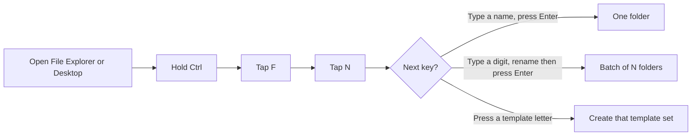
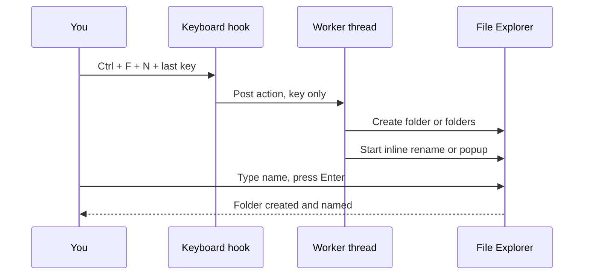

# 📁 Explorer Ctrl + F + N → New Folder


A [Windhawk](https://windhawk.net) mod for Windows File Explorer. Make a folder — **and name it in the same motion** — without touching the mouse. Also does batches and reusable folder templates.

> ⌨️ **F** for *Folder*, **N** for *Name*. Hold **Ctrl** the whole time.

Works in any real File Explorer directory, sub-folders, and the Desktop. Non-filesystem spots (*This PC*, *Quick access*) are skipped.

---

## The gesture



- **Hold Ctrl for the entire gesture.** Let go early and nothing is created.
- **Esc** cancels, or keeps the default name `New folder`.
- Only **one** shortcut is active at a time.

---

## Quick start

1. Click an empty spot in a folder or the Desktop.
2. Hold **Ctrl** → tap **F** → tap **N**.
3. Type a name → **Enter**. Done.

That is the whole thing. Batch and templates are the same gesture with a different last key.

---

## Requirements

| Need | Detail |
|---|---|
| OS | Windows with File Explorer |
| Windhawk | Installed and running ([windhawk.net](https://windhawk.net)) |

## Install

1. Open **Windhawk** → **Explore**.
2. Search for **Explorer Ctrl+F+N to New Folder**.
3. Click **Install**, then **Enable**.

Manual: Windhawk → **Create new mod** → paste the contents of `explorer-ctrlfn-newfolder.wh.cpp` → **Compile** → **Enable**.

---

## What each last key does


### One folder
Type a name, press Enter. Empty name falls back to `New folder`.

### Batch — several at once
Type a number right after the gesture, then Enter. `5` makes five folders. Cap is **100**.

Numbering never overwrites — existing folders are skipped and the batch continues past the highest number.

| Batch pattern | Result for base `New folder` |
|---|---|
| `New folder 1` *(default)* | `New folder 1`, `New folder 2`, `New folder 3` |
| `New folder-01` | `New folder-01`, `New folder-02`, `New folder-03` |
| `New folder-001` | `New folder-001`, `New folder-002`, `New folder-003` |
| `New folder_01` | `New folder_01`, `New folder_02` |
| `New folder_001` | `New folder_001`, `New folder_002` |
| `New folder (01)` | `New folder (01)`, `New folder (02)` |

---

## Folder templates

Make the **same set of folders every time** with one keypress. Press your trigger, then the template **letter** — no typing, no rename box.

Define templates in the mod settings, **one per line**:

```
key=Name=Folder1|Folder2|Folder3
```

| Line you write | Press | Creates |
|---|---|---|
| `i=Image=raw\|jpg\|png` | `i` | `raw`, `jpg`, `png` |
| `w=Work=src\|docs\|assets` | `w` | `src`, `docs`, `assets` |
| `p=Project=01 Brief\|02 Assets\|03 Final` | `p` | `01 Brief`, `02 Assets`, `03 Final` |

**Rules**

| Rule | Meaning |
|---|---|
| **key** | One letter A–Z you press after the trigger. Case-insensitive, stored lowercase. |
| **Name** | A label for your reference only. |
| **Folders** | Split on the `\|` pipe. Each piece is one folder. Spaces are kept exactly. |
| **26 templates max** | One per letter. Same key twice → the first line wins. |
| **100 folders max** | Per template. |
| **Rejected names** | Anything with `\` `/` `:` `*` `?` `"` `<` `>` `\|` `..`, or control characters, is skipped — same rules as a typed folder name. Commas are allowed. |
| **Never overwrites** | Existing folders follow the *Template name collisions* setting. |

---

## How it works under the hood

The keyboard hook stays non-blocking — it captures only the key and hands the work to a worker thread, which creates the folders **and only then** starts the rename. That ordering is what keeps naming reliable.



---

## Settings

| Setting | Default | What it does |
|---|---|---|
| **Shortcut** | `Ctrl+F+N` | Pick one of 4: `Ctrl+F+N`, `Ctrl+Shift+N`, `Ctrl+N`, `Ctrl+N+F`. Only one active at a time. |
| **Name folders with a popup box** | OFF | OFF = Explorer's inline rename box. ON = themed light/dark popup, more reliable everywhere. |
| **Multiple folders in one go** | ON | Controls **batches** only. ON = type a number for a batch. OFF = one folder. **Folder templates work either way** — a template letter always fires. |
| **Max folders per run** | 25 | Cap per trigger, range 1–100. |
| **Auto-resolve name clashes** | ON | ON = numbers past existing names. OFF = only plain `New folder`. |
| **Open the new folder after creating it** | OFF | ON = browse into it in the same window. Single-folder only. |
| **Type speed** | Normal | Grace period before the box commits on its own. Normal ≈ 1.2s / 30s, Relaxed ≈ 2.5s / 60s, Patient ≈ 4s / 120s. |
| **Batch numbering pattern** | `New folder 1` | Number style for batches. 6 options. |
| **Folder templates** | *(empty)* | Your own folder sets. One `key=Name=Folder1\|Folder2` per line. |
| **Template name collisions** | Skip | For templates only: `Skip` existing, `number` a sibling, or `stop` (create nothing). Overrides *Auto-resolve name clashes*. |

---

## Why Ctrl + F + N

| | Ctrl+F+N | Ctrl+Shift+N | Ctrl+N | Ctrl+N+F |
|---|---|---|---|---|
| Keys | Hold Ctrl, tap F then N | Windows' own New folder keys | Single press | Hold Ctrl, tap N then F |
| Keeps native Explorer shortcuts | ✅ Ctrl+F search still works | ✅ | ❌ replaces New window | ❌ replaces New window |
| Accidental-trigger risk | Low | Low | Higher | Medium |

Pick **Ctrl+F+N** to keep every native Explorer shortcut intact, or **Ctrl+Shift+N** for the exact keys Windows already uses.

---

**Author:** [Ashix](https://github.com/k-ashix) · Mod id `explorer-ctrlfn-newfolder`
